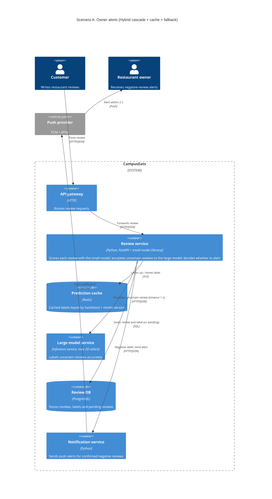

# Task 4: Deployment topologies and trade-offs

**Name / Jirapat Dangkowkiew**

**Student ID / 6632025821**

This is **individual work**: each student completes and submits their own copy, in their own fork.

*งานนี้เป็น**งานเดี่ยว** นิสิตแต่ละคนทำและส่งงานของตัวเอง ใน fork ของตัวเอง*

**Scenario (A, B or C) / Scenario ที่เลือก: A**

Choose **one** scenario below. If the last digit of your student ID is odd, take A or B; if it is even, take B or C. Use your measurements from Tutorial 6 as evidence: cite run names from `results/runs.csv`. Answer in Thai or English.

เลือก scenario **หนึ่ง** ข้อด้านล่าง ถ้าเลขตัวสุดท้ายของรหัสนิสิตเป็นเลขคี่ ให้เลือก A หรือ B ถ้าเป็นเลขคู่ ให้เลือก B หรือ C ใช้ผลการวัดจาก tutorial ที่ทำไปเป็นข้อมูลอ้างอิง โดยอ้างชื่อ run จาก `results/runs.csv` จะตอบเป็นภาษาไทยหรือภาษาอังกฤษก็ได้

Facts that hold in every scenario / ข้อเท็จจริงที่ใช้กับทุก scenario:

- The large model serves at most **20 calls per second** (4 calls at once × about 200 ms each), and every call costs money.

  *large model รับได้สูงสุด **20 calls ต่อวินาที** (พร้อมกัน 4 calls × ประมาณ 200 ms ต่อ call) และทุก call มีค่าใช้จ่าย*
- The small model is fast and cheap enough to run anywhere, including inside the review service or on a kiosk, but it is much less accurate on its own.

  *small model เร็วและถูกพอที่จะรันที่ไหนก็ได้ รวมถึงภายใน review service หรือบน kiosk แต่ถ้าใช้ตัวเดียวจะแม่นน้อยกว่ามาก*

## Scenarios

**A. Owner alerts.** When a customer posts a negative review, the restaurant owner gets a push notification within **2 seconds**. At the lunch peak, CampusEats receives **40 reviews per second**. A missed alert is acceptable, but a wrong alert (for example, "your customer is unhappy" when they are happy) makes owners stop trusting alerts and, in the end, ignore them.

*เมื่อลูกค้าโพสต์รีวิวเชิงลบ เจ้าของร้านจะต้องได้รับ push notification ภายใน **2 วินาที** เวลาช่วงพีคตอนเที่ยง CampusEats ได้รับรีวิวจำนวน **40 รายการต่อวินาที** การพลาด alert ไปบ้างนั้นยอมรับได้ แต่ alert ที่ผิด (เช่น "ลูกค้าไม่พอใจ" ทั้งที่จริงๆ แล้วพอใจ) จะทำให้เจ้าของร้านไม่เชื่อถือและเลิกสนใจ alert ในที่สุด*

**B. Canteen kiosk.** A tablet in each canteen lets students leave a review on the spot. However, the canteen Wi-Fi is poor: the tablets lose their connection several times a day, for minutes at a time. The system must accept every review, even while a tablet is offline. Restaurant owners need the labels **by the end of the day**.

*มี tablet ในแต่ละโรงอาหารให้นิสิตรีวิวได้ทันที อย่างไรก็ดี การเชื่อมต่อ Wi-Fi ในโรงอาหารไม่ดี ทำให้ tablet หลุดการเชื่อมต่อวันละหลายครั้ง ครั้งละหลายนาที ระบบจะต้องรับรีวิวได้ทุกรายการแม้ขณะที่กำลัง offline อยู่ และเจ้าของร้านต้องการ label **ภายในสิ้นวัน***

**C. Weekly report.** Restaurant owners want a weekly sentiment report. Nothing in producing this report has to be real-time. **Accuracy matters most** and **cost must be minimal**.

*เจ้าของร้านต้องการรายงาน sentiment รายสัปดาห์ ไม่มีอะไรที่จะต้องทำแบบ real-time ในการออกรายงานนี้ ความแม่นยำ **(accuracy) สำคัญที่สุด** และ **ค่าใช้จ่ายต้องน้อยที่สุด***

## Topologies and patterns to choose from / Topology และ pattern ที่เลือกใช้ได้

| | Topology | Where the model runs / โมเดลรันที่ไหน |
|---|---|---|
| T1 | Model as a service, synchronous | Inference service, called for each review (today's baseline) *inference service ถูกเรียกทุกรีวิว (baseline ของวันนี้)* |
| T2 | Model as a library | Inside the review service, or on the device *ภายใน review service หรือบนอุปกรณ์* |
| T3 | Hybrid | Small model locally, large model as a remote service *small model รันในเครื่อง large model เป็น remote service* |
| T4 | Asynchronous / batch | Reviews are queued (broker, W10) or stored, and scored later in bulk *รีวิวถูกเข้าคิว (broker, W10) หรือเก็บไว้ แล้วติด label ทีหลังเป็นชุด* |

Combine one topology with any of the patterns from Tutorial 6: **fallback**, **cascade** and **cache**.

*เลือก topology หนึ่งแบบ แล้วผสมกับ pattern จาก Tutorial 6 ได้ตามต้องการ: **fallback**, **cascade** และ **cache***

## 1. Quality requirements

The three most important quality requirements for your scenario, each with a number where possible.

*quality requirements ที่สำคัญที่สุด 3 ข้อของ scenario ที่เลือก ระบุตัวเลขเมื่อทำได้*

| # | Quality | Requirement |
|---|---|---|
| 1 | Accuracy | alert ที่ส่งออกไปต้องถูกต้องสูงสุด: รีวิวที่ถูกแจ้งว่า "เชิงลบ" ต้องเป็นเชิงลบจริง ≥ 93% ส่วนการพลาด alert ยอมรับได้ |
| 2 | Performance | ตั้งแต่ลูกค้าโพสต์จนเจ้าของร้านได้ push notification ต้องไม่เกิน 2 วินาที |
| 3 | Capacity | รับได้ 40 รีวิว/วินาทีช่วงพีคโดยไม่มี error แต่ large model รับได้แค่ 20 calls/วินาที จึงต้องส่งให้ large model ไม่เกิน 50% ของรีวิว |

## 2. Design / การออกแบบ

Your topology, the patterns you add, and a container-level diagram (C4 level 2). The C4 diagram must be written in Mermaid.

*topology ที่เลือก pattern ที่เพิ่ม และ diagram ระดับ container (C4 level 2) เขียนด้วย Mermaid*

**Topology:** T3 Hybrid โดย small model รันเป็น library อยู่ใน review service และ large model เป็น remote inference service

**Patterns:**
- **Cascade (threshold 0.7):** small model ตัดสินรีวิวที่มั่นใจ ≥ 0.7 เอง ส่วนรีวิวที่ไม่มั่นใจส่งต่อให้ large model ใช้ 0.7 เท่ากับ t3-cache เพราะที่ 0.8 ต้องใช้ 25.6 calls/s ซึ่งเกินขีดจำกัด 
- **Cache:** รีวิวข้อความซ้ำตอบจาก cache โดยไม่ต้องเรียกโมเดล ช่วยลดจำนวน call ไปยัง large model   
- **Fallback (timeout 1 s):** ถ้า large model ไม่ตอบภายใน 1 วินาที จะ**ไม่ส่ง alert** และให้รีวิวเป็น pending แล้ว label ทีหลัง เพราะการพลาด alert ยอมรับได้ แต่การเดาแล้วส่ง alert ผิดยอมรับไม่ได้
- **Alert rule:** ส่ง push notification ก็ต่อเมื่อ label สุดท้ายเป็น negative เท่านั้น

## 3. Evidence / หลักฐาน

Which runs support your choice? Show the numbers and, for scenario A, the capacity arithmetic: how many large-model calls per second does your design need at the peak?

*run ไหนที่สนับสนุนการตัดสินใจของนิสิต ให้นิสิตแสดงตัวเลขประกอบ และสำหรับ scenario A ให้นิสิตแสดงการคำนวณ capacity ด้วย เพื่อแสดงว่าในช่วงพีคนั้น design ของนิสิตต้องใช้ large model กี่ calls ต่อวินาที*

| Run | What it shows / แสดงอะไร |
|---|---|
| t0-large | accuracy 93.5% แต่ถ้าส่งทุกรีวิวให้ large model ช่วงพีคจะต้องใช้ 40 × 100% = **40 calls/s** ซึ่งเกินขีดจำกัด 20 calls/s เป็นเท่าตัว จึงใช้ T1 ไม่ได้ |
| t0-small | ใช้ small model อย่างเดียว accuracy เหลือแค่ 72.5% ประมาณ 1 ใน 4 ของ label ผิด ทำให้ alert ผิดบ่อยเกินไป จึงใช้ T2 อย่างเดียวไม่ได้ |
| t2-0.7, t2-0.8 | cascade อย่างเดียว ต้องใช้ 40 × 53% = 21.2 calls/s และ 40 × 64% = 25.6 calls/s ตามลำดับ ซึ่ง**เกิน 20 calls/s** ทั้งคู่ |
| t3-cache | cascade + cache: accuracy 93.0% (ใกล้ t0-large) large calls 38% และ p95 519 ms ช่วงพีคต้องใช้ 40 × 38% = **15.2 calls/s ≤ 20** (ใช้ประมาณ 76% ของ capacity เหลือ headroom 4.8 calls/s) |
| t1-after | timeout 1 s ทำให้ errors เหลือ 0 และ p95 1039 ms ยังต่ำกว่า 2 s แม้ large model จะค้าง รีวิวที่ค้าง 19 รายการกลายเป็น pending แทนที่จะทำให้ทั้งระบบล่ม |

**Capacity arithmetic (peak):** 40 reviews/s × 38% large calls (t3-cache) = **15.2 large calls/s** < 20 calls/s ✔

## 4. ADR

Use the ADR format from W5.

*ใช้รูปแบบ ADR จาก W5*

**Title:** ใช้ Hybrid cascade พร้อม cache และ timeout fallback สำหรับ owner alerts

**Status:** Proposed

**Context:** เจ้าของร้านต้องได้ alert รีวิวเชิงลบภายใน 2 วินาที ช่วงพีคมีรีวิว 40 รายการต่อวินาที แต่ large model รับได้แค่ 20 calls/s และทุก call มีค่าใช้จ่าย alert ที่ผิดจะทำให้เจ้าของร้านเลิกเชื่อถือ alert ส่วนการพลาด alert ไปบ้างยอมรับได้

**Decision:** รัน small model เป็น library ใน review service และส่งเฉพาะรีวิวที่ small model มั่นใจต่ำกว่า 0.7 ไปยัง large model พร้อม cache ที่ใช้ model version เป็นส่วนหนึ่งของ key ตั้ง timeout ของ large model ไว้ 1 วินาที ถ้า timeout จะไม่ส่ง alert และให้รีวิวเป็น pending เพื่อ label ทีหลัง ส่ง push notification เฉพาะรีวิวที่ label สุดท้ายเป็น negative

**Consequences:**
- Positive: ใช้ large model แค่ประมาณ 15.2 calls/s ช่วงพีค ซึ่งอยู่ในขีดจำกัด 20 calls/s และลดค่าใช้จ่ายลงประมาณ 62% เมื่อเทียบกับ t0-large ได้ accuracy 93.0% ใกล้เคียงกับ large model (t3-cache) p95 อยู่ที่ 519 ms (t3-cache) และเมื่อ large model ค้าง timeout 1 s จะตัด call นั้นไป ทำให้ p95 อยู่ที่ประมาณ 1039 ms (t1-after) ซึ่งเกิน 1 วินาทีเล็กน้อย แต่ยังมีช่องว่างก่อนถึงเป้า 2 วินาที และระบบไม่ล่ม
- Negative (trade-off ของ design): ใช้ capacity ของ large model ถึงประมาณ 76% ถ้าช่วงพีคเกิน 52 รีวิว/วินาที (20 / 0.38) จะเกินขีดจำกัด รีวิวที่ timeout จะพลาด alert ไป รีวิวที่ small model มั่นใจแต่ผิด (เช่นรีวิวประชด) จะไม่ถูกส่งให้ large model ตรวจ จึงอาจทำให้เกิด alert ผิดได้ และต้องล้าง cache ทุกครั้งที่เปลี่ยนโมเดล
- Negative (ข้อจำกัดของหลักฐาน): cache hit 35% มาจากชุดรีวิวใน load test ถ้าช่วงเที่ยงจริงมีรีวิวซ้ำน้อยกว่านี้ large calls จะสูงขึ้นจาก 15.2 calls/s (ถ้าไม่มี cache เลยจะเท่ากับ t2-0.7 คือ 21.2 calls/s ซึ่งเกินขีดจำกัด) load test วัดที่ concurrency 10 ไม่ได้วัดที่ 40 รีวิว/วินาทีจริง t1-after วัดกับ strategy `large` ไม่ได้วัดกับ design hybrid นี้ และยังไม่ได้วัดเวลาของ notification service กับ push provider เลย จึงควรทำ load test แบบ end-to-end ที่ 40 รีวิว/วินาทีกับ design จริงก่อน deploy

**Alternatives considered:**

> - **T1 (large model ทุกรีวิว):** ช่วงพีคต้องใช้ 40 calls/s ซึ่งเกินขีดจำกัด 20 calls/s (t0-large) request จะต้องเข้าคิวรอจนเกิน 2 วินาที และค่าใช้จ่ายสูงที่สุด
> - **T2 (small model อย่างเดียว):** เร็วและถูก แต่ accuracy แค่ 72.5% (t0-small) จะเกิด alert ผิดบ่อยจนเจ้าของร้านเลิกเชื่อถือ
> - **T4 (batch):** ประหยัดที่สุด แต่ label ได้ช้าเกินกว่าจะส่ง alert ภายใน 2 วินาทีได้
